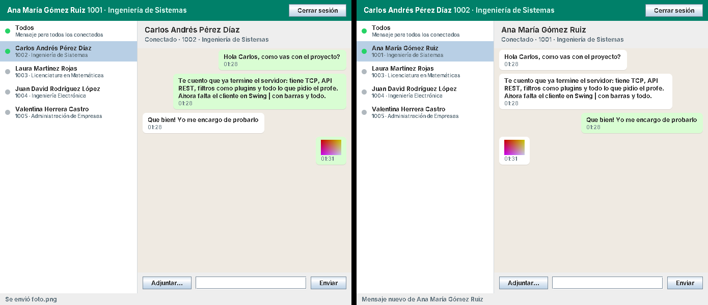
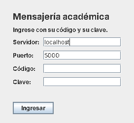
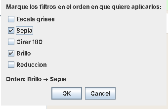
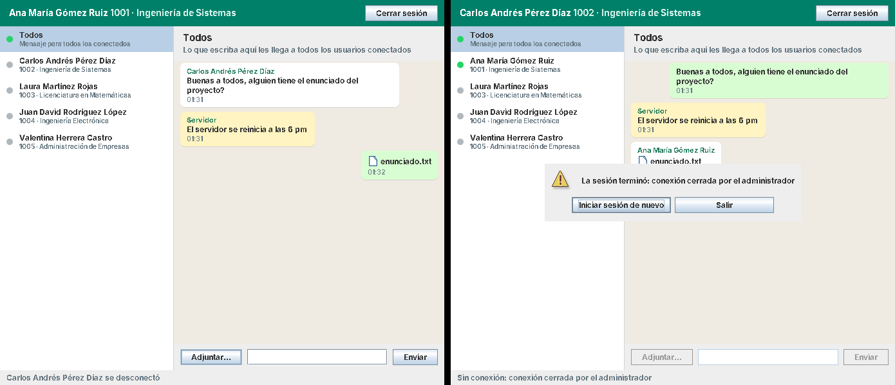

# Cliente de mensajería académica

Cliente de escritorio en **Java 21 + Swing** para el [servidor de mensajería](#el-servidor). Permite a cada estudiante iniciar sesión con su código y su clave, ver quién está conectado y conversar con otro usuario o con todos, enviando **textos, imágenes y archivos**. Al enviar una imagen se pueden **elegir los filtros** que le aplica el servidor y su orden.

- Habla con el servidor por **TCP** (puerto 5000), con el protocolo de líneas del servidor. No usa la API REST.
- Guarda el **historial de conversaciones** en una base **H2** embebida (un archivo; no hay que instalar nada) y los archivos recibidos en una carpeta de descargas.
- Sigue la página **"Cliente - Componentes"** del diagrama de clases por componentes (`docs/diagrama-clases-por-componentes.drawio`): cada componente es un jar y la vista solo conoce la fachada. Los cambios respecto al diagrama están en [Cambios respecto al diagrama](#cambios-respecto-al-diagrama).



## Aplicaciones que debe tener instaladas

| Aplicación | Versión | ¿Obligatoria? | Para qué | Cómo comprobarla |
|---|---|---|---|---|
| **JDK** (por ejemplo Eclipse Temurin) | **21** | Sí | Compilar y ejecutar el cliente | `java -version` y `javac -version` deben decir 21 |
| **Apache Maven** | 3.9 o superior | Sí, para compilar | Descargar dependencias, correr las pruebas y armar la distribución | `mvn -v` debe mostrar `Java version: 21...` |
| **El servidor de mensajería** | | Sí, para usarlo | Es a quien se conecta el cliente | La consola del servidor muestra `Servidor escuchando en el puerto 5000` |
| Conexión a Internet | | Solo la primera vez | Maven descarga H2, JUnit, Mockito y AssertJ | |

Use **Java 21**, igual que para el servidor: las versiones de JUnit y Mockito del `pom.xml` son las mismas del servidor. Si tiene varios JDK, verifique que `JAVA_HOME` apunte al 21.

## Ejecutar

```bash
mvn package                                                          # compila los 7 módulos, corre las 105 pruebas y arma la distribución
java -jar inicio/target/cliente-mensajeria/cliente-mensajeria.jar    # usa config/cliente.properties
java -jar inicio/target/cliente-mensajeria/cliente-mensajeria.jar otra/config.properties
```

1. Arranque primero el servidor (`java -jar servidor/target/servidor-mensajeria/servidor-mensajeria.jar` en la carpeta del servidor).
2. Arranque el cliente **desde la carpeta del proyecto del cliente**: las rutas de la configuración (`config/`, `datos/`) son relativas a la carpeta actual. Si no encuentra `config/cliente.properties`, usa los valores por defecto (servidor `localhost:5000`).
3. Ingrese con un usuario del servidor: códigos `1001` a `1005`, clave `clave` + código (por ejemplo `clave1001`).
4. Para simular varios usuarios, **abra varios clientes** en el mismo equipo, uno por usuario. Comparten la base del historial sin estorbarse (ver [Varios clientes en el mismo equipo](#varios-clientes-en-el-mismo-equipo)).
5. Para conectarse a un servidor en otro equipo, escriba su IP en el campo **Servidor** de la ventana de inicio de sesión (o en `servidor.host`). En el equipo del servidor, el firewall debe permitir el puerto 5000.

Para llevar el cliente a otro equipo, copie la carpeta `inicio/target/cliente-mensajeria/` completa (trae su propio `config/`) y arránquelo desde ella. Ojo: `mvn clean` borra esa carpeta.

### Configuración (`config/cliente.properties`)

| Clave | Por defecto | Efecto |
|---|---|---|
| `servidor.host`, `servidor.puerto` | `localhost`, `5000` | Servidor al que se conecta. Se pueden cambiar en la ventana de inicio de sesión. |
| `bd.url` | `jdbc:h2:./datos/historial;AUTO_SERVER=TRUE;DB_CLOSE_DELAY=-1` | Base local del historial. `AUTO_SERVER` deja que varios clientes del mismo equipo la compartan y `DB_CLOSE_DELAY=-1` la mantiene abierta mientras el cliente corre. **No quite esas dos opciones.** |
| `bd.usuario`, `bd.contrasena` | `sa`, vacía | Usuario de la base H2 (se crea sola) |
| `descargas.directorio` | `datos/descargas` | Dónde se guardan los archivos e imágenes enviados y recibidos |
| `filtros.disponibles` | `escala_grises,sepia,girar_180,brillo,reduccion` | Filtros que se ofrecen al enviar una imagen. Póngale los mismos de `filtros.activos` del servidor. |
| `archivos.tamanoMaximoBytes` | `10485760` (10 MB) | Tamaño máximo de un archivo. Póngale el mismo `mensajes.tamanoMaximoBytes` del servidor: si se envía un archivo más grande, el servidor cierra la conexión, así que el cliente lo rechaza antes. |

### Qué queda guardado en disco

```
datos/
  historial.mv.db                     ← base H2: todas las conversaciones de todos los usuarios de este equipo
  descargas/
    1001/                             ← una carpeta por usuario del cliente
      5af69fd2-..._foto.png           ← <id del mensaje>_<nombre del archivo>, enviados y recibidos
      709e02c2-..._enunciado.pdf
    1002/
      ...
```

El servidor no les envía a los clientes las conversaciones anteriores, así que el historial lo guarda cada cliente: al volver a iniciar sesión, cada conversación muestra lo que se habló antes en ese equipo.

## Cómo se usa

| Pantalla | Qué hace |
|---|---|
|  | **Inicio de sesión.** Servidor, puerto, código y clave. Si el servidor rechaza la entrada, muestra el motivo en rojo: `Credenciales inválidas`, `Límite de usuarios conectados alcanzado` o `No se pudo conectar con localhost:5000`. |

**Ventana principal** (captura de arriba):

- **Contactos**, a la izquierda: primero **Todos** y después cada usuario registrado, con un punto **verde** si está conectado y **gris** si no. El punto cambia solo cuando alguien entra o sale. Si llega un mensaje de una conversación que no está abierta, el contacto se pone en **negrita** con el aviso **● nuevo**.
- **Conversación**, a la derecha: los mensajes propios van a la derecha en verde y los recibidos a la izquierda en blanco. En **Todos** cada mensaje recibido dice quién lo envió, y los mensajes del administrador del servidor salen en amarillo como **Servidor**.
- **Escribir**: Enter o **Enviar**. El texto puede tener cualquier carácter, incluidos `|` y tildes.
- **Adjuntar…**: elige un archivo. Si es una imagen, aparece el diálogo de filtros. En la conversación las imágenes se ven en miniatura y los demás archivos con su ícono y su nombre. **Doble clic** sobre un mensaje con archivo lo abre con el programa del sistema.
- **Cerrar sesión**: vuelve a la ventana de inicio de sesión. Cerrar la ventana también cierra la sesión.

| Diálogo de filtros | |
|---|---|
|  | Los filtros se aplican **en el orden en que se marcan**: aquí, primero brillo y después sepia. Si no se marca ninguno, el servidor aplica todos los de `filtros.activos`, como pide el requisito. El destinatario recibe la imagen original; las versiones filtradas quedan en el servidor (`01_brillo.png`, `02_sepia.png`). |



**Si la sesión termina sin que el usuario la cierre** (el administrador cerró la conexión, el servidor se detuvo o se perdió la red), aparece un aviso con el motivo y dos opciones: **Iniciar sesión de nuevo** o **Salir**. Mientras tanto no se puede escribir.

## Componentes (jars)

Cada componente de la página "Cliente - Componentes" del diagrama es un **módulo Maven y un jar**. Un módulo solo declara como dependencia los componentes hacia los que el diagrama dibuja una flecha, y `ArquitecturaTest` lo comprueba sobre el código y sobre los `pom.xml`.

| Capa del diagrama | Componente (módulo y paquete) | Clases | Usa |
|---|---|---|---|
| 1. Inicio | `inicio` | `InicioCliente` | utilerias, vista, fachada, dto |
| 2. Presentación (Swing) | `vista` | `VentanaLogin`, `VentanaChat`, `RenderizadorMensaje` (+ `PanelesChat`, `RenderizadorContacto`, `SelectorFiltros`, `SegundoPlano`) | fachada, dto |
| 2. Presentación (Swing) | `utilerias` | `LectorConfiguracion` | dto |
| 3. Fachada | `fachada` | `ObservadorCliente`, `IFachadaCliente`, `FachadaCliente`, `FabricaCliente` | comunicacion, persistencia, dto |
| 4. Servicios técnicos | `comunicacion` | `IConexionServidor`, `ConexionServidorTCP`, `Protocolo` (+ `ErrorDelServidorException`) | — |
| 4. Servicios técnicos | `persistencia` | `IRepositorioMensajesLocal`, `RepositorioMensajesH2` (+ `ErrorPersistencia`) | dto |
| 5. DTO | `dto` | `UsuarioRemoto`, `MensajeChat`, `TipoMensaje`, `ConfiguracionCliente` | — |

- **La vista no puede ver la comunicación ni la persistencia.** En `fachada/pom.xml` esas dos dependencias son `<optional>`, así que no pasan de forma transitiva a quien usa la fachada: si una ventana importara `ConexionServidorTCP`, no compilaría.
- **Solo `FabricaCliente` conoce las implementaciones** (`ConexionServidorTCP` y `RepositorioMensajesH2`). `FachadaCliente` recibe sus interfaces por el constructor.
- Swing y AWT solo se usan en `vista` e `inicio`.

`mvn package` arma una carpeta lista para ejecutar o copiar:

```
inicio/target/cliente-mensajeria/
  cliente-mensajeria.jar    InicioCliente; Main-Class y Class-Path hacia componentes/ y lib/
  componentes/              los otros 6 jars del diagrama
    cliente-dto-1.0.0.jar           cliente-comunicacion-1.0.0.jar   cliente-persistencia-1.0.0.jar
    cliente-fachada-1.0.0.jar       cliente-utilerias-1.0.0.jar      cliente-vista-1.0.0.jar
  lib/                      h2-2.3.232.jar
  config/                   copia de config/
```

## Cómo funciona el código

### Arranque

1. `InicioCliente.main` lee `config/cliente.properties` con `LectorConfiguracion` y obtiene una `ConfiguracionCliente`.
2. `FabricaCliente.crear(config)` arma una fachada nueva: crea la `ConexionServidorTCP` y el `RepositorioMensajesH2` (que crea la tabla si no existe) y se los pasa a `FachadaCliente`.
3. `VentanaLogin` es modal: `mostrar()` vuelve cuando el usuario entró o cerró la ventana. Si entró, se abre `VentanaChat`, que se registra como **observadora** de la fachada y pide la lista de usuarios.
4. Al cerrar sesión se repite el paso 2 con una fachada nueva, para que una sesión no herede observadores de la anterior.

### Una petición (por ejemplo, enviar un texto)

1. `VentanaChat.enviarTexto` pasa el trabajo a `SegundoPlano`, un hilo aparte, para que la ventana no se congele. Es un solo hilo, así que los mensajes salen en el orden en que se escribieron.
2. `FachadaCliente.enviarTexto` llama a `conexion.pedir("TEXTO", destino, texto)`.
3. `ConexionServidorTCP.pedir` escribe la línea `TEXTO|1002|Hola` (con `Protocolo.unir`, que escapa `|`, `\` y los saltos de línea) y espera la respuesta en su cola `respuestas`. Si es `OK|id` devuelve `[id]`; si es `ERROR|motivo` lanza `ErrorDelServidorException(motivo)`, y ese motivo es el que ve el usuario.
4. La fachada guarda el mensaje en el historial y lo devuelve; la ventana lo agrega a la conversación, de nuevo en el hilo de Swing.

`enviarArchivo` es igual con `ARCHIVO|destino|nombre|base64[|filtros]`: antes de enviar revisa que el archivo no esté vacío ni supere el máximo, y después guarda una copia en las descargas.

### Lo que llega del servidor sin pedirlo

```
socket ──► hilo "lector-servidor" ──► OK / ERROR ──► cola de respuestas ──► pedir()
                                  └─► NOTIF ──────► hilo "notificaciones-servidor" ──► FachadaCliente.atenderNotificacion
                                                                                        ├─ MENSAJE   → guarda archivo e historial → mensajeRecibido
                                                                                        ├─ PRESENCIA → presenciaCambiada
                                                                                        └─ CIERRE    → conexionCerrada (una sola vez)
```

- El lector distingue las respuestas de las notificaciones por el primer campo, como indica el protocolo del servidor.
- Las notificaciones se atienden en otro hilo, así que guardar una imagen grande no retrasa la respuesta a una petición.
- Si el servidor corta la conexión sin avisar, el lector genera un `CIERRE` con el motivo `se perdió la conexión con el servidor`, y la petición que estuviera esperando falla enseguida en vez de esperar 30 segundos.
- `VentanaChat` recibe los avisos de la fachada (`ObservadorCliente`) en el hilo de notificaciones y los pasa al hilo de Swing con `SwingUtilities.invokeLater`.

### A qué conversación pertenece un mensaje

| Notificación | Conversación (`contacto`) |
|---|---|
| `destino = *` (de un usuario o del `SERVIDOR`) | **Todos** (`*`) |
| `origen` = yo (me escribí a mí mismo) | `destino` |
| cualquier otra | `origen` |

### Varios clientes en el mismo equipo

H2 deja un archivo de bloqueo mientras la base está abierta. Con `AUTO_SERVER=TRUE`, el primer cliente que la abre atiende a los demás por un puerto local. `DB_CLOSE_DELAY=-1` hace que ese primer cliente la mantenga abierta: sin esa opción cada cliente abre y cierra la base en cada operación, y con dos clientes se estorban (en las pruebas hubo esperas de hasta 8 segundos y errores `Lock file recently modified`). Si el primer cliente se cierra, otro toma la base; para ese relevo `RepositorioMensajesH2` reintenta cada operación hasta 3 veces.

## El servidor

El cliente usa estas partes del protocolo TCP descrito en la sección *Protocolo TCP* del README del servidor (texto UTF-8, una línea por mensaje, campos separados por `|`):

| Petición | Respuesta | Lo usa |
|---|---|---|
| `LOGIN\|codigo\|clave` | `OK\|codigo\|nombres\|apellidos\|programa` | `iniciarSesion` |
| `USUARIOS` | `OK\|n\|codigo\|nombres\|apellidos\|programa\|conectado\|…` | `listarUsuarios` |
| `TEXTO\|destino\|texto` | `OK\|idMensaje` | `enviarTexto` |
| `ARCHIVO\|destino\|nombreArchivo\|base64[\|filtros]` | `OK\|idMensaje` | `enviarArchivo` |
| `SALIR` | `OK` | `cerrarSesion` |

| Notificación | Efecto en el cliente |
|---|---|
| `NOTIF\|MENSAJE\|id\|origen\|destino\|tipo\|fecha\|contenido\|nombreArchivo\|base64` | Guarda el archivo (si trae) y el mensaje, y lo muestra |
| `NOTIF\|PRESENCIA\|codigo\|1` o `\|0` | Punto verde o gris en el contacto |
| `NOTIF\|CIERRE\|motivo` | Aviso de sesión cerrada |

## Cambios respecto al diagrama

| # | Cambio | Motivo |
|---|---|---|
| C1 | `IFachadaCliente.enviarArchivo(destino, archivo, filtros)`. El `enviarArchivo(destino, archivo)` del diagrama queda como método por defecto (sin filtros). Se agregó `filtrosDisponibles()`. | El servidor permite que el cliente elija los filtros de cada imagen (cambio E1 del servidor). |
| C2 | `ConfiguracionCliente` agrega `filtrosDisponibles` y `tamanoMaximoBytes`. | Ofrecer los filtros del servidor y rechazar un archivo demasiado grande antes de enviarlo: el servidor cierra la conexión si una línea supera su máximo. |
| C3 | `ErrorDelServidorException` en `comunicacion` (una `IOException`). `pedir` devuelve los campos después de `OK`; la escucha recibe las notificaciones sin el `NOTIF`. | El motivo de `ERROR\|motivo` llega intacto a la ventana sin que la vista dependa de la comunicación. |
| C4 | Si la conexión se pierde, `ConexionServidorTCP` entrega un `CIERRE` a la escucha. | Que el usuario se entere aunque el servidor se haya caído sin avisar. |
| C5 | La vista suma `PanelesChat` (construcción de los paneles), `RenderizadorContacto`, `SelectorFiltros` y `SegundoPlano`. | Responsabilidad única: `VentanaChat` queda con el comportamiento y bajo las 300 líneas; ninguna petición al servidor congela la ventana. |
| C6 | `VentanaLogin(fachada, host, puerto)` y `VentanaChat(fachada, alCerrarSesion)`. `RenderizadorMensaje` recibe una función con el nombre de cada código. | Llenar el servidor y el puerto desde la configuración, volver al inicio de sesión al cerrarla y mostrar nombres en la conversación con todos. |
| C7 | `RepositorioMensajesH2` usa la clave (propietario, id) y `MERGE`, reintenta ante un fallo de conexión y lanza `ErrorPersistencia`. | Dos usuarios en el mismo equipo tienen cada uno su copia, un mensaje repetido no se duplica y varios clientes comparten la base. |
| C8 | Proyecto multimódulo: un jar por componente; `fachada` declara `comunicacion` y `persistencia` como opcionales. | Igual que en el servidor, los componentes son unidades desplegables, y el compilador impide que la vista use la comunicación o la persistencia. |

## Principios y patrones aplicados

### SOLID

| Principio | Dónde se aplica |
|---|---|
| **S**: responsabilidad única | `Protocolo` solo da formato a las líneas, `ConexionServidorTCP` solo transporta, `RepositorioMensajesH2` solo guarda, `PanelesChat` solo arma la ventana y `VentanaChat` solo reacciona. |
| **O**: abierto/cerrado | Un transporte nuevo (por ejemplo la API REST del servidor) sería otra `IConexionServidor`, y otra base sería otro `IRepositorioMensajesLocal`, sin tocar la fachada ni la vista. Un filtro nuevo del servidor solo se agrega en `filtros.disponibles`. |
| **L**: sustitución de Liskov | La fachada funciona igual con la conexión TCP real o con un doble de prueba, y con H2 o con un repositorio en memoria (así la prueban `FachadaClienteTest` y `ClienteExtremoAExtremoTest`). |
| **I**: segregación de interfaces | `ObservadorCliente` tiene solo los tres avisos que necesita la vista; `IRepositorioMensajesLocal`, solo dos métodos. |
| **D**: inversión de dependencias | `FachadaCliente` recibe interfaces por constructor y solo `FabricaCliente` conoce las clases concretas. |

### GRASP

| Patrón | Clase |
|---|---|
| Controlador | `FachadaCliente`: cada acción de la vista es un método suyo |
| Creador | `FabricaCliente` |
| Experto en información | `FachadaCliente.contactoDe` sabe a qué conversación va un mensaje, `Protocolo` sabe escapar, `RepositorioMensajesH2` sabe el SQL |
| Bajo acoplamiento | La vista solo conoce `IFachadaCliente`, `ObservadorCliente` y los DTO |
| Indirección y variaciones protegidas | `IConexionServidor` e `IRepositorioMensajesLocal` |
| Fabricación pura | `Protocolo`, `SegundoPlano`, `LectorConfiguracion` |

### Otros patrones

Fachada (`IFachadaCliente`), Observer (`ObservadorCliente`), Fábrica (`FabricaCliente`), Repositorio (`IRepositorioMensajesLocal`), Productor-consumidor (el hilo lector llena la cola de respuestas y la de notificaciones) y Renderer de Swing (`RenderizadorMensaje`, `RenderizadorContacto`).

## Pruebas

La suite tiene **105 pruebas** escritas con JUnit 5, Mockito y AssertJ. Todas viven en el módulo `inicio`, que depende de los demás, así que `mvn test` desde la raíz las corre sobre los 7 módulos. Corren sin pantalla (`java.awt.headless=true`) y sin el servidor real.

```bash
mvn test                                       # todas
mvn test -Dtest=FachadaClienteTest             # una clase
mvn test -Dtest="ClienteExtremoAExtremoTest"   # solo extremo a extremo
```

| Clase | Pruebas | Qué cubre |
|---|---|---|
| `ProtocoloTest` | 15 | Escape de `\|`, `\`, saltos de línea; campos nulos y vacíos; ida y vuelta con cualquier texto (tildes, emoji, barras) |
| `ConexionServidorTCPTest` | 11 | Contra un socket manejado por la prueba: `OK` y `ERROR`, notificación intercalada antes de la respuesta, orden de las notificaciones, servidor que corta, `cerrar()` sin aviso, tiempo de espera, respuesta inesperada, peticiones de varios hilos, reconexión y puerto cerrado |
| `RepositorioMensajesH2Test` | 7 | Orden por fecha, separación por propietario y contacto, sin duplicados, todos los campos (textos largos con símbolos), historial que sobrevive al reinicio y URL inválida |
| `LectorConfiguracionTest` | 10 | Valores por defecto sin archivo, lectura de todas las claves en UTF-8, normalización de filtros, puerto y tamaño inválidos, y que `config/cliente.properties` sea válido |
| `DtoTest` | 4 | `UsuarioRemoto.todos()`, `nombreCompleto`, `conConexion`, `enviadoPorMi` y la inmutabilidad de `ConfiguracionCliente` |
| `FachadaClienteTest` | 26 | Con la conexión simulada (Mockito): inicio y cierre de sesión, lista de usuarios, texto y archivo con y sin filtros, límites de tamaño, notificaciones (texto, archivo, para todos, a uno mismo, mal formadas), presencia, cierre una sola vez, nombre de archivo con `../` y fallos del historial |
| `VistaTest` | 12 | Sin pantalla: alineación de las burbujas, remitente en Todos, ajuste del texto, miniaturas, imagen perdida, orden del selector de filtros, aviso de no leído y `SegundoPlano` |
| `ClienteExtremoAExtremoTest` | 8 | Dos y tres clientes completos (TCP, H2 en archivo y descargas) contra `ServidorDePrueba`, un servidor mínimo que habla el mismo protocolo: presencia, texto, imagen con filtros, para todos, mensaje del administrador, cierre por el servidor, caída del servidor, clave incorrecta e historial tras reiniciar |
| `ArquitecturaTest` | 5 | Cada componente usa solo los del diagrama; un módulo por componente; solo la fábrica conoce las implementaciones; Swing solo en vista e inicio; los `pom.xml` declaran las dependencias del diagrama |
| `MetricasCalidadTest` | 7 | Con los umbrales del servidor: métodos ≤ 50 líneas, complejidad ≤ 10, ≤ 7 parámetros, clases ≤ 300 líneas, ≤ 15 métodos públicos y sin `instanceof` |

Además, el cliente se probó a mano contra el **servidor real** (ver la lista siguiente), con dos clientes gráficos en el mismo equipo: las capturas de este README son de esa prueba.

## Lista de verificación manual

Con el servidor arrancado (`bd.habilitada=false` sirve) y dos o tres clientes abiertos:

- [ ] `mvn package` termina en `BUILD SUCCESS` con `Tests run: 105, Failures: 0, Errors: 0`.
- [ ] Clave incorrecta → `Credenciales inválidas`. Con el servidor apagado → `No se pudo conectar con localhost:5000`.
- [ ] Ana entra; luego entra Carlos → en la ventana de Ana, Carlos pasa a verde y la barra de estado dice que se conectó.
- [ ] Ana le escribe a Carlos mientras él tiene abierta otra conversación → Carlos ve a Ana en negrita con **● nuevo**; al abrirla aparece el mensaje.
- [ ] Un texto largo, con tildes y con `|`, llega igual y se ajusta en varias líneas.
- [ ] **Todos** → el mensaje llega a todos los conectados con el nombre de quien lo envió.
- [ ] Adjuntar una imagen marcando brillo y luego sepia → en el servidor, `datos/archivos/<id>/` tiene `01_brillo.png` y `02_sepia.png`; Carlos ve la miniatura. Sin marcar ninguno → se aplican los cinco.
- [ ] Adjuntar un PDF → aparece con su ícono; doble clic lo abre. El archivo está en `datos/descargas/<código>/`.
- [ ] En la consola del servidor, `todos Hola` → todos los clientes ven el aviso amarillo **Servidor** en Todos.
- [ ] `cerrar-usuario 1002` → Carlos ve *La sesión terminó: conexión cerrada por el administrador*; Ana lo ve en gris. *Iniciar sesión de nuevo* lo devuelve a la ventana de inicio.
- [ ] Ana entra también desde otro cliente → recibe los mensajes en las dos ventanas.
- [ ] Cerrar el cliente y volver a abrirlo → las conversaciones siguen ahí.
- [ ] Detener el servidor (`salir`) → todos los clientes avisan que la sesión terminó.

## Estructura

Cada carpeta con `pom.xml` es un módulo Maven y produce un jar.

```
pom.xml                   proyecto padre: los 7 módulos y las versiones
config/                   cliente.properties
docs/                     diagrama de clases por componentes (draw.io) y capturas
dto/                      UsuarioRemoto, MensajeChat, TipoMensaje, ConfiguracionCliente          capa 5
comunicacion/             IConexionServidor, ConexionServidorTCP, Protocolo, ErrorDelServidorException
persistencia/             IRepositorioMensajesLocal, RepositorioMensajesH2, ErrorPersistencia   capa 4
fachada/                  ObservadorCliente, IFachadaCliente, FachadaCliente, FabricaCliente     capa 3
utilerias/                LectorConfiguracion
vista/                    VentanaLogin, VentanaChat, PanelesChat, RenderizadorMensaje,
                          RenderizadorContacto, SelectorFiltros, SegundoPlano                    capa 2
inicio/                   InicioCliente                                                          capa 1
  src/test/java/          todas las pruebas: soporte/ (ServidorDePrueba, AnalizadorFuentes…),
                          integracion/, arquitectura/, calidad/ y una carpeta por componente
  target/cliente-mensajeria/   la distribución lista para ejecutar
```
